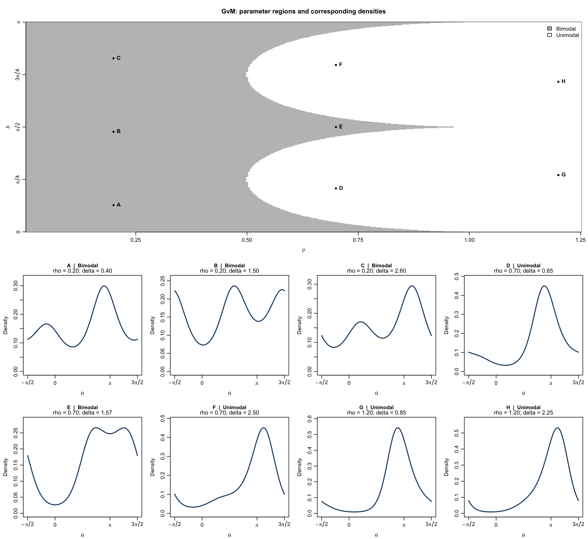

# Unimodality and bimodality of the generalized von Mises distribution

A substantial part of my PhD research focused on studying the bimodality of the generalized von Mises (GvM) distribution. This small collection of R scripts illustrates how its parameters determine whether the circular density has one mode or two.

The density considered here is proportional to

```text
exp(kappa1 * cos(theta - mu1) + kappa2 * cos(2 * (theta - mu2)))
```

Here, `mu1` and `mu2` are angular location parameters, and `kappa1` and `kappa2` are non-negative concentration parameters. Angles are expressed in radians.

For `kappa2 > 0`, the modality regions are represented using:

```text
rho   = kappa1 / (4 * kappa2)
delta = (mu1 - mu2) modulo pi, with 0 <= delta < pi
```

Grey indicates the bimodal region; white indicates the unimodal region. The transition curve separates the two regimes; the example points are chosen away from this boundary.

## Files

| File | Purpose |
| --- | --- |
| `GvM.Rproj` | RStudio project: opens this folder as the working directory, without restoring a saved workspace. |
| `gvm_normalizing_constant.R` | Defines `G0()`, the normalising constant computed using a Fourier–Bessel series. The density is normalised by dividing its exponential term by `2 * pi * G0()`. The stopping rule uses the unsigned series coefficient to avoid premature termination on negative or nearly zero cosine terms. |
| `plot_gvm.R` | Defines `plot_gvm(mu1, mu2, kappa1, kappa2)`. It draws a single normalised GvM density for the supplied parameters and returns the density function invisibly. It loads the normalising-constant file automatically. |
| `plot_rho_delta.R` | Defines `is_bimodal()` and `plot_rho_delta()`. It classifies parameter pairs using a quartic-root criterion, draws the grey/white regions, and returns the computed grid invisibly. Use `draw = FALSE` to compute the grid without drawing it. |
| `compare_gvm_modality.R` | Reuses the region grid and the density plotting function to create a combined figure: eight labelled points in the parameter plane, followed by their corresponding densities. It saves PNG and PDF versions and checks density normalisation and the number of modes on a circular grid. |

## Run the examples

Only base R is required; no additional R packages are needed.

Open **`GvM.Rproj`** in RStudio. This automatically sets the working directory to the `GvM` folder, so no `setwd()` call or computer-specific path is needed. Then run the examples below in the R console.

If you use R without RStudio, start R from the `GvM` folder. The scripts load their dependencies and save their output relative to this working directory.

Plot one density:

```r
source("plot_gvm.R")
plot_gvm(mu1 = pi/6, mu2 = pi/6 + pi/2, kappa1 = 1, kappa2 = 2)
```

Plot the modality regions without points:

```r
source("plot_rho_delta.R")
regions <- plot_rho_delta()
```

Generate the combined comparison:

```r
source("compare_gvm_modality.R")
```

The comparison uses three bimodal examples at `rho = 0.2`; two unimodal examples and one bimodal example at `rho = 0.7`; and two unimodal examples at `rho = 1.2`. It fixes `mu1 = pi` and `kappa2 = 0.4`, then derives `mu2` and `kappa1` from each selected `(rho, delta)` pair.

The resulting files are `compare_gvm_modality.png` and `compare_gvm_modality.pdf`.

## Numerical scope

The region plot uses a finite grid and numerical root tolerances, so its boundary is an approximation. The mode-count check is also grid-based. The unscaled Bessel series is intended for moderate concentrations and may overflow for large parameter values.


